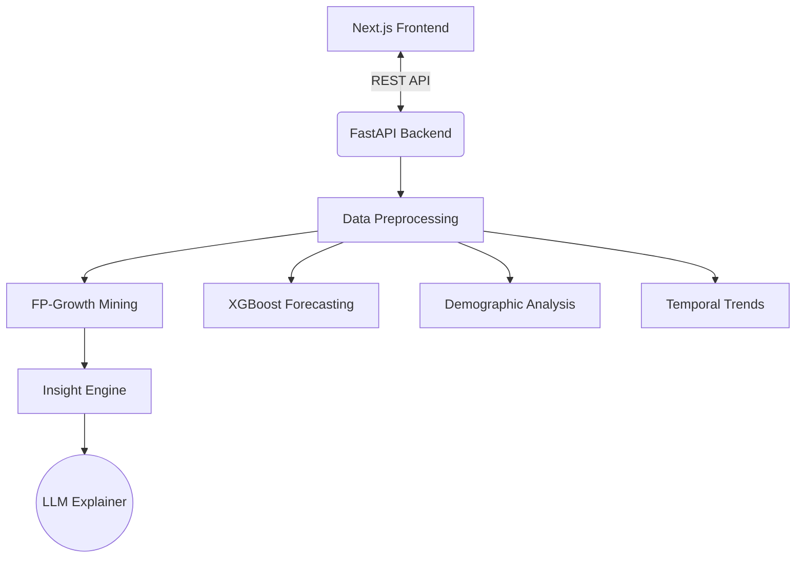

# Intelligent Pattern Discovery Engine

## Overview
This is an Explainable AI / Machine Learning academic project for discovering hidden patterns in enterprise/e-commerce transaction datasets. It provides automated mining, predictive analytics, and natural language explanations.

## Problem Statement
Traditional analytics dashboards often present raw statistics without explaining *why* they matter or contextualizing their importance. Furthermore, identifying association rules manually or running predictive models requires significant data science overhead. This engine automates the process and uses an LLM to generate plain-English, evidence-backed explanations of complex statistical patterns (Explainable AI).

## Architecture
The application uses a decoupled Next.js + FastAPI full-stack architecture.



## Technology Stack
- **Frontend**: Next.js (App Router), React, TypeScript, Tailwind CSS, shadcn/ui, Recharts
- **Backend API**: FastAPI, Uvicorn, Pydantic
- **Data & ML**: pandas, numpy, scikit-learn, xgboost, mlxtend
- **Explainable AI**: OpenAI API (configurable for Llama/Ollama via Base URL)

## Installation & Setup

You will need to run two separate processes for the backend and frontend.

### 1. Backend (FastAPI)

1. **Clone & Environment**
   ```bash
   cd backend
   python3 -m venv venv
   source venv/bin/activate
   pip install -r requirements.txt
   ```

2. **Configuration**
   Copy `.env.example` to `.env`:
   ```bash
   cp .env.example .env
   ```
   Add your API keys if you wish to use the natural language explanation feature. The analytical pipeline functions perfectly without an API key.

3. **Run Backend Server**
   ```bash
   uvicorn main:app --reload --port 8000
   ```

### 2. Frontend (Next.js)

1. **Install Dependencies**
   ```bash
   cd frontend
   npm install
   ```

2. **Environment**
   (Optional) If your backend is running on a different port, set `NEXT_PUBLIC_API_URL` in `.env.local`.

3. **Run Frontend Server**
   ```bash
   npm run dev
   ```
   
Open `http://localhost:3000` in your browser.

## Synthetic Demo Data
The backend includes a pre-generated synthetic dataset (`backend/data/sample_transactions.csv`) that simulates an e-commerce electronics store. It is completely reproducible via `backend/src/utils/data_generator.py` and strictly used for academic demonstration.

## Academic Note
This project emphasizes reproducibility, correctness, and evidence-grounded AI. It does not fabricate benchmark results or claim causal inference from observational correlations.
